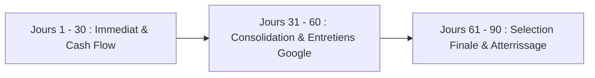

# Plan d'Action 30-60-90 Jours : Cash Flow Montpellier & Pipeline Google Paris

Ce plan d'action operationnel detaille la feuille de route pour generer immediatement du cash flow et des missions tech a Montpellier tout en preparant et franchissant les etapes de recrutement pour Google Paris.

---

## Calendrier Strategique Global

---

## Phase 1 (Jours 1 a 30) : Activation Locale, Cash Flow & Fondations

### Objectifs Clés

- Generer une premiere opportunite d'embauche ou mission freelance a Montpellier (TJM 450 - 650 EUR ou CDI 50 - 65k EUR).
- Mettre a niveau le profil technique, le portfolio GitHub et aligner le CV aux normes internationales FAANG.
- Initialiser la routine d'entrainement aux entretiens algorithmiques et system design.

### Actions Semaine 1 a 2 : Profiling et Ciblage Local

1. **Packaging Professionnel** :
   - Redaction du CV bilingue (francais/anglais), format 1 page concis, quantifie (metriques STAR : impact chiffre, temps d'execution reduit, volume de requetes traite).
   - Optimisation du profil LinkedIn et Malt : Titre percutant `Senior Software Engineer | Rust, TypeScript, Python | Cloud & AI Architect`.
   - Mise en avant des realisations concretes sur GitHub (projets cloud GCP, architectures Bun/Rust performantes, integrateurs d'agents IA).
2. **Attaque Directe du Marche Montpellierain** :
   - Candidature ciblee aupres de **Teads** (Engineering Hub Montpellier) sur postes Backend / Platform / Data.
   - Prospection proactive des ESN et cabinets experts regionaux (Zenika, Ippon, ChapsVision, startups BIC).
   - Prise de contact directe avec 5 chasseurs de tete tech specialistes du Sud (Urban Linker, Expectra Tech, Michael Page).

### Actions Semaine 3 a 4 : Routine Technique Google

1. **Algorithmes & Data Structures** :
   - 1 probleme LeetCode Medium par jour (focus tableaux, deux pointeurs, chaines, arbres binaires, BFS/DFS).
   - Redaction de solutions propres en Python ou C++/Rust avec explication systematique de la complexite Big-O.
2. **Consolidation GCP & Architecture** :
   - Certification ou preparation intensive : `Google Cloud Professional Cloud Architect` ou `Professional Data Engineer` / `ML Engineer`.
   - Realisation d'un projet de demonstration complet sous GCP (Vertex AI, Cloud Run, Cloud Storage, Terraform).

---

## Phase 2 (Jours 31 a 60) : Sécurisation Locale & Déclenchement Pipeline Google Paris

### Objectifs Clés

- Entree en poste ou demarrage de contrat a Montpellier pour etablir la tresorerie et la stabilite financiere.
- Declenchement du processus de candidature Google Paris via recommandation (Referral) ou contact recruteur.
- Intensification de la preparation technique (System Design a grande echelle et Googliness).

### Actions Semaine 5 a 6 : Concrétisation Locale

1. **Finalisation des Offres Locales** :
   - Passer les tests techniques et entretiens a Montpellier.
   - Verrouiller une offre avec une bonne remuneration et de preference une flexibilite de travail (teletravail hybride permettant de preparer Google).
2. **Activation du Reseau Google** :
   - Recherche de pairs ou d'anciens collaborateurs travaillant actuellement chez Google Paris (via LinkedIn et communautes tech GDG).
   - Obtention d'un **Employee Referral** officiel pour les postes ouverts :
     - _Software Engineer L4/L5 (Paris)_
     - _Customer Engineer, Google Cloud / AI (Paris)_
   - Soumission de la candidature interne.

### Actions Semaine 7 a 8 : Preparation Technique Approfondie Google

1. **System Design Loop** :
   - Etude des architectures classiques : Design de YouTube, Design d'un Rate Limiter distribue, Design d'un systeme de Web Crawler scalable, Design d'une API d'inference LLM multi-tenant.
   - Maitrise des concepts : Sharding horizontal, CAP Theorem, Cache-Aside vs Write-Through, consistent hashing, replication synchrone/asynchrone.
2. **Googliness & Behavioral Prep** :
   - Redaction de 10 histoires vécues au format STAR illustrant :
     - Resolution d'un conflit technique complexe sans autorite formelle.
     - Gestion d'un echec critique en production et post-mortem blame-free.
     - Prise de decision audacieuse dans un environnement hautement ambigu.
     - Simplification d'un processus pour le benefice exclusif de l'utilisateur.

---

## Phase 3 (Jours 61 a 90) : On-site Loops, Décision et Négociation

### Objectifs Clés

- Reussir le Technical Phone Screen et l'On-site Interview Loop Google Paris (4 a 5 entretiens).
- Franchir avec succes le Hiring Committee et la phase de Team Matching.
- Negocier le package global de remuneration (salaire de base, bonus annuel, actions RSUs Google).

### Actions Semaine 9 a 10 : Passage de la Hiring Loop

1. **Mock Interviews a Blanc** :
   - Simulation en conditions reelles (45 minutes chrono, sans editeur avance, restitution orale continue des reflexions et hypothese de calcul).
   - Entrainement System Design sur tableau blanc / Google Drawings.
2. **Deroulement des Entretiens Google** :
   - Maintien d'une communication claire, structuration des reponses (clarification du besoin avant tout codage, validation des cas limites, complexite spatio-temporelle explicite).

### Actions Semaine 11 a 12 : Team Matching et Négociation

1. **Team Matching Calls** :
   - Echanges avec les Engineering Managers et Directeurs d'equipes a Paris (Google Cloud, AI, Core Systems).
   - Evaluation de l'adequation projet, de l'impact metier et du plan de progression.
2. **Validation Hiring Committee & Offre** :
   - Reception de l'offre d'embauche (Job Offer).
   - Utilisation de la position locale a Montpellier comme levier pour negocier sereinement le package salarial (alignement marche FAANG Paris).
   - Signature et plan de transition.
