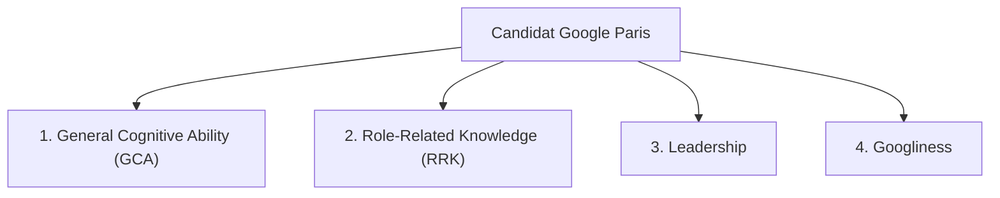

# Google Paris — Roadmap de Recrutement & Standards d'Evaluation

## 1. Contexte du Hub Google Paris

Le bureau de Google France (8 Rue de Londres, Paris 9e) et ses entites associees (Google Cloud France, R&D Chrome/AI/Systemes) abritent des equipes majeures :

- **Google Cloud Engineering & Sales Consulting** : Customer Engineering, Professional Services (PSO), Solutions Architecture, Specialisation AI / Data / Infra.
- **R&D / Core Engineering** : Equipes d'ingenierie de pointe contribuant aux projets globaux (Chrome/Blink, IA fondamentale, infrastructure reseau et securite).
- **Google DeepMind / AI Research Hub** : Laboratoires de recherche et de deploiement en intelligence artificielle appliquee.

---

## 2. Rôles Vises et Grilles de Qualification

### A. Software Engineer (SWE) — Niveaux L4 (Mid-Level) / L5 (Senior)

- **Missions** : Conception et developpement de systemes distribues massifs, micro-services a haute disponibilite, bibliotheques et moteurs de calcul.
- **Prerequis Techniques** :
  - Maitrise solide d'au moins un langage principal de Google : C++, Go, Python, Java, ou Rust.
  - Maitrise irreprochable des structures de donnees et algorithmes (arbres, graphes, programmation dynamique, complexite spatio-temporelle Big-O).
  - System Design a grande echelle : sharding, replication, cache (Redis/Memcached), load balancing, transactions distribuees, consensus (Paxos/Raft).
- **Attentes L4 vs L5** :
  - _L4 (Software Engineer III)_ : Autonomie technique complete sur des sous-systemes, qualite du code, robustesse des tests, revues de code exemplaires.
  - _L5 (Senior Software Engineer)_ : Leadership technique, conception d'architectures transverses avec ambiguite elevee, mentorat, definition de standards.

### B. Customer Engineer (CE) — Google Cloud / AI Specialist (L4/L5)

- **Missions** : Avant-vente technique de haut niveau, co-conception d'architectures GCP pour les clients Enterprise (CAC 40, grands groupes EMEA, scale-ups licornes), prototypage de PoCs (Proof of Concept) et production d'architectures de reference.
- **Prerequis Techniques** :
  - Expertise approfondie sur Google Cloud Platform : IAM, GKE, Cloud Run, BigQuery, Spanner, Pub/Sub, Vertex AI.
  - Pratique du code applique : Python, TypeScript, Bash, Terraform pour deployer des demonstrations fonctionnelles et des architectures d'agents (RAG, Gemini API, LangGraph, Model Garden).
  - Aisance relationnelle et restitution C-Level (CTO, VP Eng, RSSI).
  - Bilinguisme professionnel francais et anglais obligatoire pour le marche francais.

### C. Solutions Architect (SA) / Cloud Consultant (PSO)

- **Missions** : Accompagnement strategique et implementation de projets de migration et d'adoption cloud a grande echelle.
- **Prerequis** :
  - Connaissance des architectures multi-cloud, securite cloud (Zero Trust, BeyondCorp), conformite reglementaire (SecNumCloud, RGPD).
  - Capacite a resoudre des goulots d'etranglement complexes de performance et de scalabilite.

---

## 3. Grille d'Evaluation Officielle Google

Les entretiens Google reposent sur 4 piliers d'evaluation stricts :

### 1. General Cognitive Ability (GCA)

- Capacite a resoudre des problemes complexes, analyser des situations ambiguës et apprendre rapidement.
- Prise de decision basee sur la donnee : evaluation des compromis (trade-offs), hypothese, validation methodique.

### 2. Role-Related Knowledge (RRK)

- Competences metier pures selon la piste (Coding, System Design, GCP Architecture, Machine Learning, Securite).
- Capacite a ecrire du code propre sans IDE avec verification de bordure (edge cases) et complexite minimale.

### 3. Leadership

- Leadership d'influence (sans autorite hierarchique directe).
- Prise d'initiative, resolution de conflits techniques, debrouillardise et alignement d'equipes pluridisciplinaires.

### 4. Googliness

- Alignement culturel : bienveillance, humilite intellectuelle, volonte de faire la bonne chose pour l'utilisateur.
- Aisance dans l'ambiguite, transparence, reception active du feedback et esprit de collaboration.

---

## 4. Structure des Boucles d'Entretiens (Hiring Loop)

### Etape 1 : Recruiter Phone Screen (30 min)

- Verification du parcours, des motivations, de la cohesion de l'experience et validation du niveau de langue (anglais/francais).

### Etape 2 : Technical Screen / Phone Interview (45 min)

- _Piste SWE_ : 1 session live coding (Google Docs ou environnement dedie sans auto-completion), algorithmique pure, focus complexite.
- _Piste Customer Engineer / SA_ : Scenario d'architecture client, diagnostic d'infrastructure ou presentation d'une solution cloud.

### Etape 3 : On-site Loop (Virtuel ou Paris 9e — 4 a 5 entretiens de 45 min)

1. **Coding 1 & Coding 2** (SWE) : Algorithmes et structures de donnees avancees.
2. **System Design / Cloud Architecture** : Conception d'un systeme distribue mondial ou d'une plateforme d'IA generative d'entreprise.
3. **Googliness & Leadership** : Questions comportementales formulees sous la methode STAR (Situation, Task, Action, Result) avec focus sur l'ethique et l'impact.
4. **Customer Presentation / Role Play** (pour Customer Engineers) : Demonstration technique ou cadrage d'un cas d'usage complexe face a un panel jouant les clients.

---

## 5. Criteres de Scoring & Comite de Recrutement (Hiring Committee)

- Chaque interviewer redige un rapport detaille et attribue une note :
  - _Strong No Hire (1)_
  - _No Hire (2)_
  - _Leaning Hire (3)_
  - _Hire (4)_
  - _Strong Hire (5)_
- Les dossiers anonymises sont soumis au **Hiring Committee (HC)** independant, qui tranche sans droit de veto du recruteur.
- Etape finale : **Team Matching** et validation par la direction EMEA pour l'offre finale (Comp Package L4/L5 : Base + Bonus + Stock Units GSUs).
